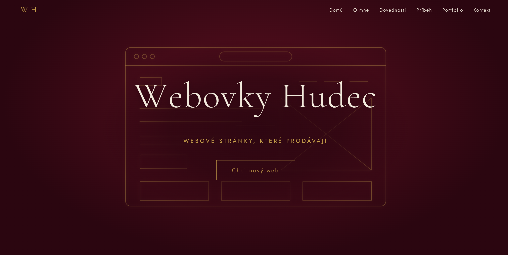

# Webovky Hudec

Osobní web a portfolio **Webovky Hudec** - weby na míru, které prodávají. Postavený ručně v čistém HTML, CSS a JavaScriptu, bez frameworků a šablon.

**Živá ukázka:** https://hudecdamian.github.io/webovkyhudec/



## Co web umí

- **Plně responzivní** - od 320 px (malý mobil) přes tablet a laptop až po 4K monitory (2560 px a víc)
- **Mobilní menu** s hamburgerem a ovládáním klávesnicí (Esc zavře menu)
- **Animace bez knihoven** - kreslení drátěného modelu webu v hero sekci, postupné odhalování obsahu při scrollu, animované ukazatele dovedností a časová osa
- **Ukazatel postupu** při scrollu a zvýraznění aktivní sekce v navigaci
- **Kontaktní formulář** přes `mailto:` (bez serveru)
- **Přístupnost** - viditelný focus, popisky formulářových polí, respektování `prefers-reduced-motion`
- **Rychlost** - žádné závislosti kromě písem Google Fonts

## Použité technologie

| Technologie | Využití |
| --- | --- |
| HTML5 | sémantická struktura stránky |
| CSS3 | grid, flexbox, vlastní proměnné, `rem` škálování, media queries |
| JavaScript (vanilla) | scroll efekty, IntersectionObserver, mobilní menu |
| Google Fonts | Cormorant Garamond, Jost |

## Responzivita

Celý web se škáluje přes `rem`, takže na velkých monitorech stačí změnit velikost písma na `<html>`.

| Zařízení | Šířka |
| --- | --- |
| 4K | 2560 px a víc |
| Laptop L | 1440 px |
| Laptop | 1024 px |
| Tablet | 768 px |
| Mobile L / M / S | 425 / 375 / 320 px |

## Struktura projektu

```
.
├── index.html     # obsah stránky
├── style.css      # vzhled a responzivita
├── script.js      # animace a interakce
├── img/
│   └── foto.jpg   # portrét
└── README.md
```

## Spuštění lokálně

Stačí stáhnout repozitář a otevřít `index.html` v prohlížeči. Není potřeba nic instalovat.

```bash
git clone https://github.com/hudecdamian/webovkyhudec.git
cd https://github.com/hudecdamian/webovkyhudec
```

## Nasazení

Web běží na GitHub Pages: v repozitáři **Settings → Pages** vyber větev `main` a složku `/ (root)`.

## Kontakt

Máte zájem o nový web? Napište mi na [damihudec@gmail.com](mailto:damihudec@gmail.com).

---

© 2026 Webovky Hudec
